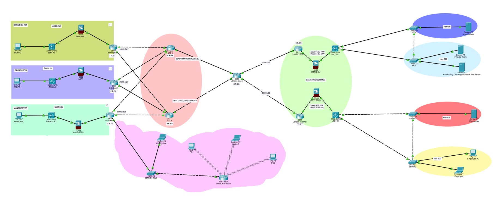
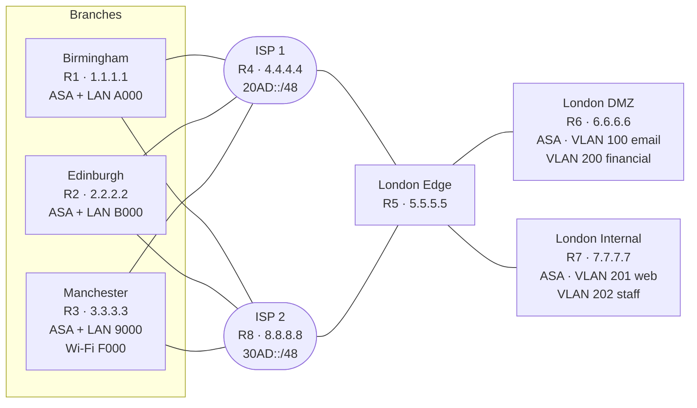
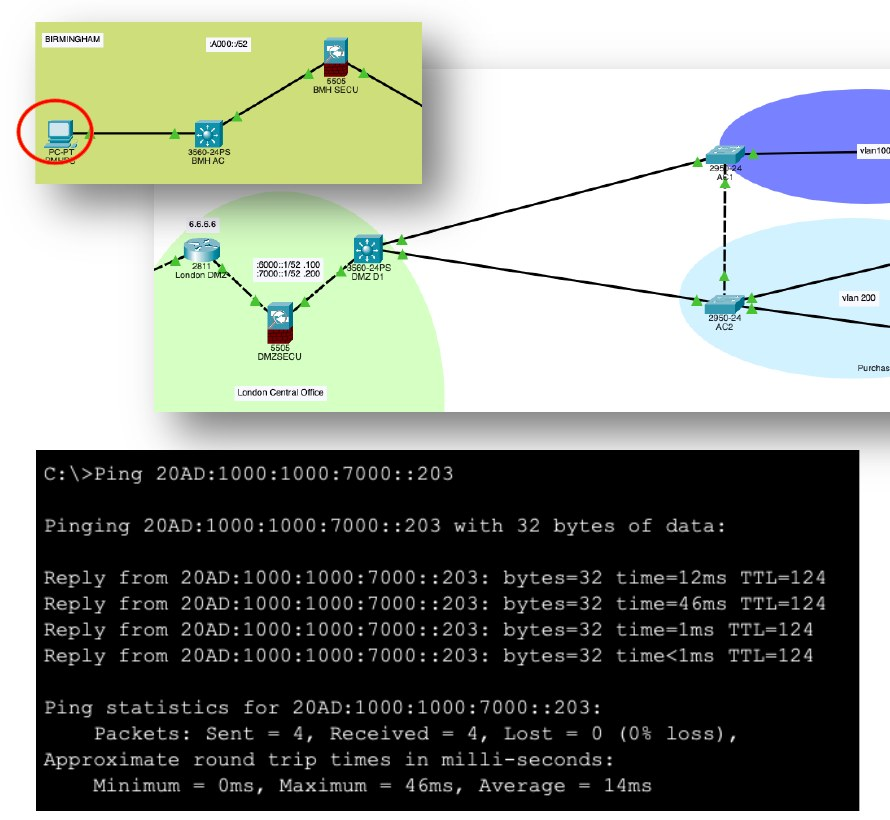
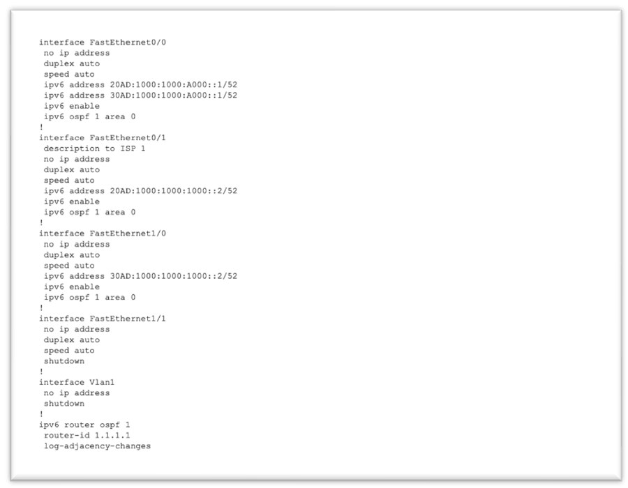
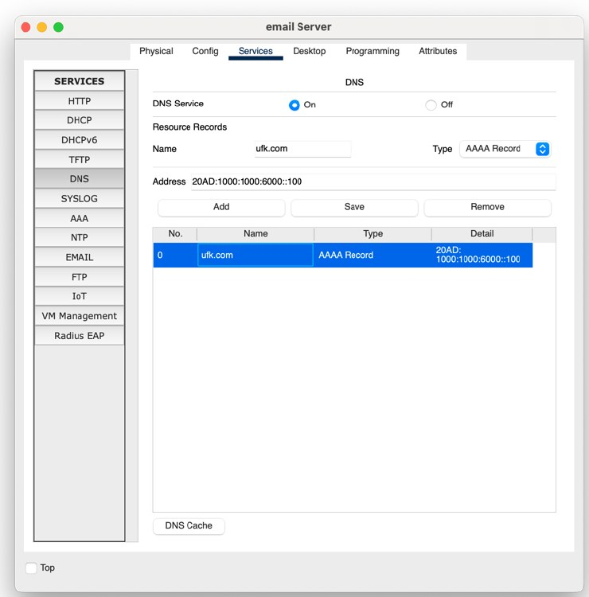
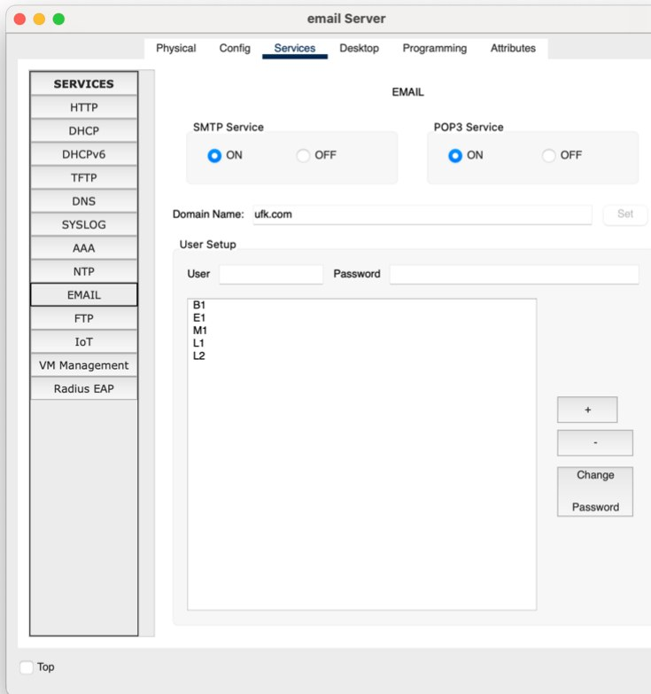

# Multi-Site Enterprise Network: Design & Build (IPv6)

A resilient, multi-homed IPv6 network for a financial trading company, linking a new **London trading floor** to regional offices in **Birmingham, Manchester and Edinburgh**. Designed from business requirements, then built and tested in **Cisco Packet Tracer**.

> University project · BSc (Hons) Cybersecurity and Networks, Teesside University / MDIS
> Module: Network Infrastructure (CIS2011-N / CIS2014-N) · April 2024 · Author: **Pyae Sone Htun**



---

## The brief

**UKF** (a case-study company) runs trading floors across the UK. Its old network couldn't meet modern availability and performance needs. The project had to support:

| Requirement | Target |
|---|---|
| Users | 500 traders, 45 support staff, 15 managers |
| Trading floor availability | **99.999%** (core hours 6 am to 6 pm) |
| Support services availability | 99% |
| Trading transaction time | **< 1 ms** (other transactions < 5 ms) |
| Lifespan | Future-proof for 5 to 10 years |
| Extra | Wireless access for mobile devices, 25% lower power use over 10 years |

## What I built

- **Two ISPs (multi-homing):** every site connects to both providers, so losing one ISP doesn't take the business offline.
- **IPv6 throughout:** a hierarchical addressing plan with a `/52` per segment under each ISP prefix ([addressing plan](addressing/ipv6-addressing-plan.md)).
- **OSPFv3 (area 0)** on all 8 routers, with unique router IDs `1.1.1.1` to `8.8.8.8`.
- **A firewall at every site:** Cisco ASA 5505 firewalls sit between each router and its LAN.
- **London DMZ:** the email server and financial-floor servers are separated from the internal network.
- **VLAN segmentation:** VLAN 100 (email server), 200 (financial team and file servers), 201 (web server) and 202 (employees), routed with 802.1Q sub-interfaces.
- **Services:** a DNS server with an IPv6 AAAA record for `ufk.com`, and an SMTP/POP3 email server with accounts for each office.
- **Wireless:** a Linksys WRT300N access point in Manchester for mobile devices.

### Logical layout



## Results

Connectivity was tested from the Birmingham PC to every site and server: **13 of 14 tests have a captured result, and all 13 show 0% packet loss.** Details in [verification/connectivity-tests.md](verification/connectivity-tests.md).

| Evidence | |
|---|---|
| End-to-end ping, Birmingham → London file server |  |
| Birmingham router: IPv6 + OSPFv3 |  |
| DNS AAAA record for `ufk.com` |  |
| Email server: SMTP + POP3 |  |

## Security design

| Control | Where | Why it matters |
|---|---|---|
| Firewalls (Cisco ASA) | Every branch, DMZ and London Internal | Filters traffic at each site boundary |
| DMZ | London | Internet-facing services can't reach internal hosts directly |
| VLAN segmentation | London DMZ and Internal | Limits lateral movement if one segment is compromised |
| Dual ISPs + redundant links | WAN | Availability: no single point of failure |
| Unused ports shut down | All routers | Reduces attack surface |
| IPsec / VPN (proposed) | Remote and site-to-site access | Encrypts traffic between sites and remote workers |

The second report also researches VPN technology: WireGuard, OpenVPN, IKEv2/IPsec, L2TP/IPsec, SSTP and PPTP, hardware vs software vs cloud VPNs, legal issues and remote administration.

## Repository structure

```
├── README.md
├── configs/
│   ├── README.md                 # what each config contains + transcription notes
│   ├── routers/                  # R1–R8 Cisco IOS configs (IPv6 + OSPFv3)
│   └── switches/                 # DMZ trunk and access-port configs
├── addressing/
│   ├── ipv6-addressing-plan.md   # readable plan: subnets, hosts, router IDs
│   └── ipv6-addressing-plan.csv  # same plan as data
├── verification/
│   └── connectivity-tests.md     # 14 ping tests and results
├── scripts/
│   └── check_configs.py          # checks configs for consistency (stdlib only)
├── images/                       # topology and evidence screenshots
├── docs/
│   ├── ICA1-Network-Design-Proposal.pdf
│   └── ICA2-Implementation-and-VPN-Report.pdf
└── packet-tracer/                # place for the .pkt project file
```

## Check the configs yourself

```bash
python3 scripts/check_configs.py
```

It confirms each router has a unique OSPFv3 router ID, all addresses fall inside the ISP prefixes, both ends of each of the 11 point-to-point links match, and every subnet is in the addressing plan.

## Skills shown

Enterprise network design · IPv6 addressing and subnetting · OSPFv3 routing · Multi-homing and redundancy · Firewall and DMZ design · VLAN segmentation (802.1Q) · DNS and email services · VPN technologies · Technical documentation

## What I'd improve next

- Re-run and capture the ISP 2 ping test (test 3), and add tests for failover (shutting down one ISP link).
- Add the full Manchester and London DMZ configs.
- Add ACLs on the ASA firewalls and document the rule base.
- Send router and firewall logs to a syslog server or SIEM, so the network can be monitored for security events.

## Reports

- [ICA 1: Network Design Proposal (PDF)](docs/ICA1-Network-Design-Proposal.pdf)
- [ICA 2: Implementation and VPN Report (PDF)](docs/ICA2-Implementation-and-VPN-Report.pdf)

---

**Pyae Sone Htun** · Network & Security Engineer, Singapore
[Portfolio](https://zone88-bot.github.io) · [LinkedIn](https://www.linkedin.com/in/pyaesonehtun787945/) · [GitHub](https://github.com/Zone88-bot)
